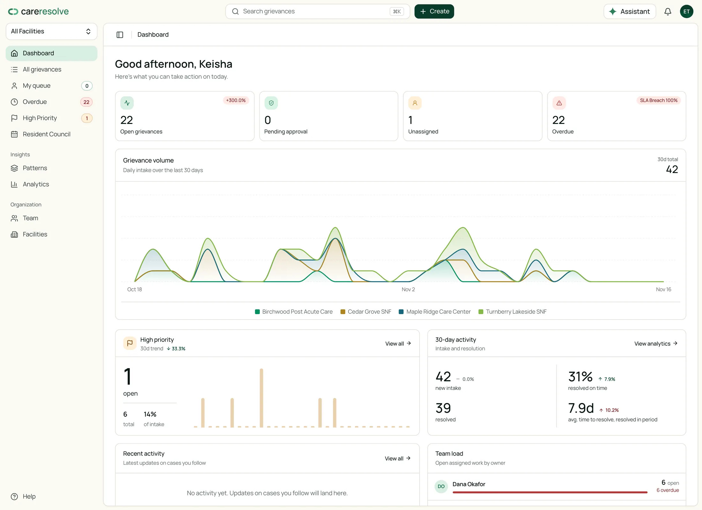

The sidebar moves you between work areas and sets the facility scope. The top bar keeps search, **Create**, Assistant, notifications, and your account available everywhere.

<Frame caption="The dashboard with the sidebar, facility switcher, global search, Create, Assistant, notifications, and account controls.">
  
</Frame>

## Move around

The sidebar is grouped into three sections:

- **Inbox:** Dashboard, All grievances, My queue, Overdue, High Priority, and Resident Council. **Pending my approval** also appears here when a resolution is waiting for your sign-off.
- **Insights:** Patterns and Analytics.
- **Organization:** Team and Facilities.

What appears depends on your role. Counts beside the queues respect your role and facility scope.

Use the top bar to:

- Search grievances.
- Open the **New grievance** composer from **Create**.
- Open **Assistant** in a side panel.
- Review notifications.
- Manage your account from your avatar.

On phones and small tablets, the sidebar collapses into a menu. Open it to reach navigation, the facility switcher, **New grievance**, help, and your account.

## Change facility scope

The facility switcher sits at the top of the sidebar. It changes the scope for dashboard metrics, grievance lists, queue counts, search defaults, and contextual exports.

Administrators can work across the organization or select one facility. Members see only facilities they can access. If a record seems missing, check facility scope before changing filters.

## Search grievances

Open the top-bar search or press **Command+K** on macOS or **Ctrl+K** on Windows.

- With no query, search shows recently viewed grievances.
- As you type, it shows the best matches inside your access scope.
- Results can include status, source and attachment indicators, grievance ID, title, facility, assignee, created date, and a short preview.

On wider screens, filter results by received date, facility, assignee, status, category, F-tag, attachments, intake source, Resident Council submission, employee involvement, third-party involvement, or anonymous reporter.

## Search meetings

Open **Resident Council** and select its search action to search meeting titles and notes. Use the meeting-page facility selector to narrow the results, then open a result on its full page.

Meeting search is separate from the top-bar grievance search.

## Account, notifications, and help

Select your avatar to open **Account settings**, switch workspaces when you belong to more than one organization, or sign out. Account settings contains Profile, Security, Notifications, and Appearance.

The notification bell shows recent activity, unread state, and links back to the related record. Use its action menu to mark all notifications read or open notification preferences.

The help menu is at the bottom of the sidebar. It offers **Contact support**, **Give feedback**, **Report a bug**, and **View docs**. Support, feedback, and bug forms ask you to confirm that your message contains no PHI: describe the problem without resident names, room numbers, narratives, or attachments.

<CardGroup cols={2}>
  <Card title="View and filter grievances" icon="list-filter" href="/grievance-log/view-and-filter">
    Narrow the grievance log, assign in bulk, export CSV data, or prepare PDF reports.
  </Card>
  <Card title="Assistant" icon="messages-square" href="/insights/assistant">
    Ask about the page you are on and review proposed changes.
  </Card>
  <Card title="Account and appearance" icon="circle-user-round" href="/settings/account-and-appearance">
    Manage personal settings and workspace switching.
  </Card>
  <Card title="Mentions and notifications" icon="bell" href="/grievance-log/mentions-and-notifications">
    Learn which case activity notifies teammates.
  </Card>
  <Card title="Meeting notes" icon="notebook-tabs" href="/meetings/manage-meetings">
    Create, search, edit, and lock facility meetings.
  </Card>
  <Card title="Privacy and PHI" icon="shield" href="/reference/privacy-and-phi">
    Keep sensitive case information in approved systems.
  </Card>
</CardGroup>
