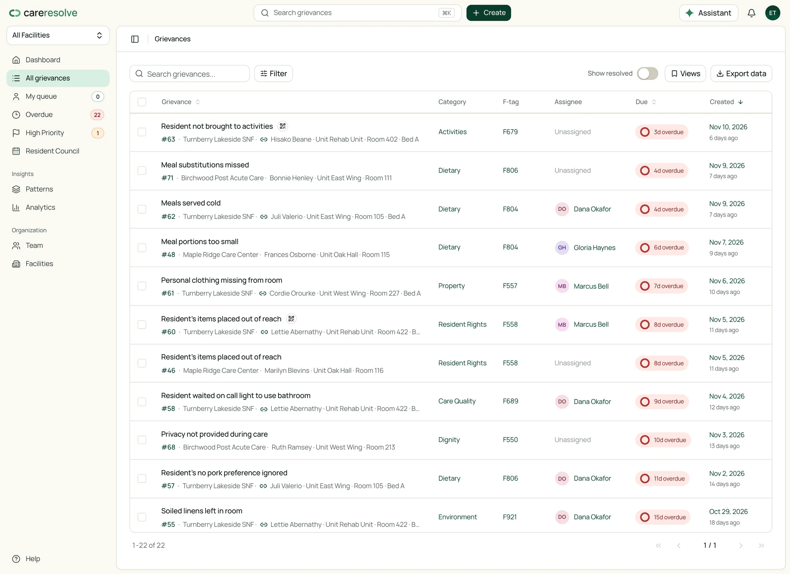

Use the grievance list to work open cases, find older records, and prepare for leadership or survey review.

Use the facility switcher at the top of the sidebar first when you need to change facility scope. Then use the list filters to narrow the results.

<Frame caption="The grievance log combines facility scope, filters, status signals, and sortable columns.">
  
</Frame>

## Open and resolved modes

**All grievances** shows open grievances by default.

Turn on **Show resolved grievances** to switch the list to resolved records. This is a separate resolved mode; it does not add resolved rows to the open list.

For top bar search, recently viewed grievances, result previews, and search-side filters, see [Navigate and search](/getting-started/navigate-and-search).

## Filter the list

Select **Filter** above the list. Available filters in open mode include:

- **Date range** over the received date.
- **Status**: Pending Approval, Overdue, or High Priority. Open is the default list mode.
- **Category**.
- **F-tag**.
- **Assignee**, including Me or Unassigned.
- **Other**: Has attachments, Public submission, Submitted at Resident Council, Employee involved, Third party concern, or Anonymous reporter.

In resolved mode, the **Status** filter includes High Priority plus the advisory compliance-review results **Aligned**, **Minor gaps**, and **Significant gaps**. These review results appear only for resolved grievances with a current review for their selected F-tag.

Select **Reset filters** to clear page filters without changing a scoped queue such as My queue.

Use **Views** to save the current filters as a named view and return to it later. Saved views are kept in your browser on the current device.

## Read list signals

Each row shows the title with the grievance number, facility, and resident location beneath it. The row can also show:

- A QR badge for a public form submission, or a phone marker for a concern-line call.
- A PointClickCare marker beside a resident selected from the synced directory.
- A paperclip and count when attachments are present.
- High Priority, Overdue, and Pending Approval markers.

In open mode, the **Due** column shows the SLA due state and any Pending Approval progress. In resolved mode, the **Resolved** column shows when the grievance was finalized and, when available, its advisory compliance-review result.

## Search the grievance list

Search can match case identifiers and narrative information across the grievance record, including titles, resident or involved-person information, case notes, attachment information, resolution fields, and timeline activity.

List search stays inside your facility access and the current open or resolved mode. For broader searching from anywhere in the app, use the top bar search.

## Sort the list

Open grievances default to **Created**, newest first. Resolved grievances default to **Resolved**, newest finalization first.

Select the **Grievance**, **Due** or **Resolved** (depending on the current mode), or **Created** column header to change the sort column or direction.

Sorting changes order only; it does not change which records match.

## Open or select grievances

Select a row to open the complete case record.

Use row checkboxes to act on several grievances at once. **Assign _N_** assigns the selected grievances to one person or clears their assignee; resolved grievances, ones pending approval, and ones in a facility the assignee cannot work are skipped. **Export _N_** downloads the selection as a CSV or a full-detail PDF. Selected actions apply to the chosen records even when the table is paginated.

<Card title="Export data and generate reports" icon="file-down" href="/grievance-log/export-and-generate-reports">
  Export matching or selected grievances as CSV, or generate a full-detail PDF report.
</Card>
