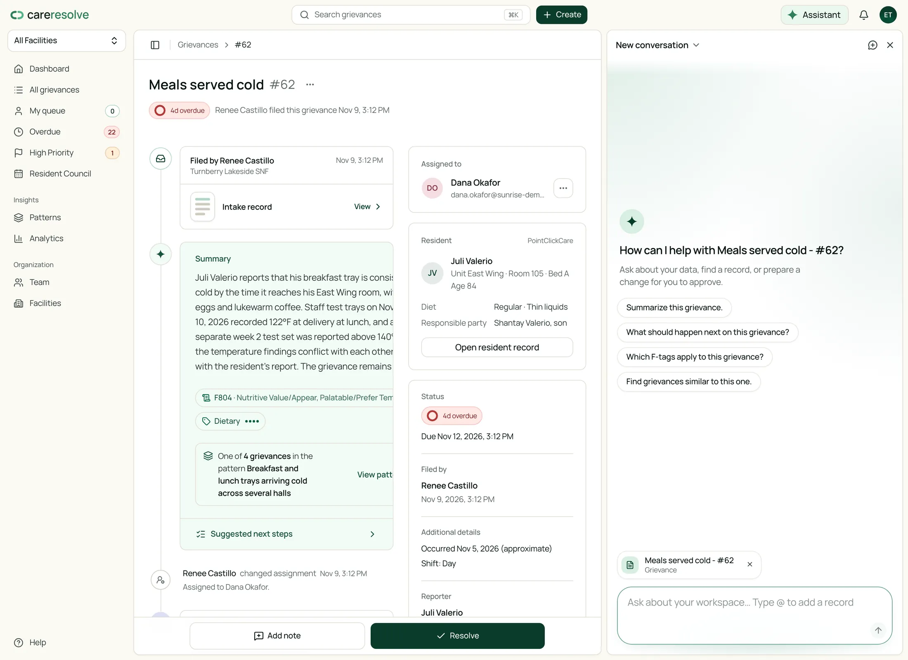

Assistant helps you find, summarize, and act on grievance work you can access. It opens in a side panel, so you can keep the page you are working on in view.

It can search, summarize, and cite relevant grievances, meetings, and patterns, answer federal Appendix PP questions, help you find public intake sharing tools, and propose changes for you to review. It does not replace the grievance record or human review.

## Open Assistant

Select the **Assistant** button in the top bar. The panel stays open as you move between pages.

Assistant knows which page you have open. The **Current page** chip shows the record or list it will use as context, such as the grievance on screen. Remove the chip when your question is not about that page.

<Frame caption="Assistant opens beside the page you are on and uses it as context.">
  
</Frame>

To ask about other records, type `@` in the message box to add a grievance, meeting, or pattern, or attach a clean file from a grievance you can access.

## What Assistant can help with

Use Assistant for questions such as:

- Which grievances are overdue?
- What open concerns mention dietary service?
- Which High Priority cases need review?
- What patterns are active for a facility?
- Summarize this grievance for leadership preparation.
- What does F585 require for a written grievance decision?
- Which Appendix PP guidance covers bed rails used as a restraint?
- Give me the public intake link or QR code for a facility.
- Assign these three grievances to the Director of Nursing.

Results that list records can appear as tables with a **Download** link.

For step-by-step product help, Assistant links to these docs.

## Review proposed changes

When you ask Assistant to change something, such as assigning grievances or inviting a teammate, it does not act on its own. It shows a **Review change** card listing what will change and which records are affected.

Nothing is changed until you apply the card. You can deselect records before applying. A preview that has been open too long expires; ask again to get a fresh one.

Assistant can only propose actions your role already allows, including case notes, assignment, F-tag changes, meeting updates, and resolution steps. Every applied change is recorded in the same timeline and audit history as a change made by hand. Assistant never resolves a grievance or approves a resolution without your review of the card.

## Access scope

Assistant respects your role and facility access.

Admins can ask across the organization. Members receive answers scoped to facilities they can access.

If a request could apply to more than one facility, Assistant may ask you to choose one. If a user cannot get an answer about a grievance or facility, check their facility access.

When you ask for public intake sharing tools, Assistant can return the facility's permanent public intake URL and a QR card with **Copy link**, **Download poster**, and **Download PNG** actions.

## Federal regulatory questions

Assistant can retrieve federal Appendix PP guidance in two ways:

- For a specific F-tag or topic, it can open the corresponding regulatory profile.
- For a broader question, everyday wording, or an issue that spans several tags, it can search the stored Appendix PP passages and return the most relevant F-tags.

F-tag citations appear as selectable chips. Select a chip to open the tag's **Guidance**, **How to prepare**, and **Source** tabs.

Assistant's regulatory answers cover the federal corpus available in CareResolve. They do not include state-specific requirements and should not be treated as legal advice or a compliance decision.

<Card title="Regulatory guidance" icon="book-open-check" href="/triage-and-labels/regulatory-guidance">
  Review the guidance window, open-case next steps, and post-resolution compliance review.
</Card>

## Saved conversations

Conversations are saved so you can return to them. Open the conversation history in the panel to search, reopen, rename, or delete a conversation, or start a new one.

A reply keeps being written if you close the panel or reload the page. You can stop a reply while it is in progress.

## Citations, F-tags, and grievance cards

Assistant may include grievance cards, links to case records, or F-tag chips.

Open the grievance or guidance source to review the underlying material before relying on the answer.

## Use carefully

Assistant may summarize sensitive grievance information. Do not paste PHI into outside tools or use Assistant output as the complete case record.

AI output is advisory. Staff remain responsible for review, follow-up, resolution, and compliance decisions.
