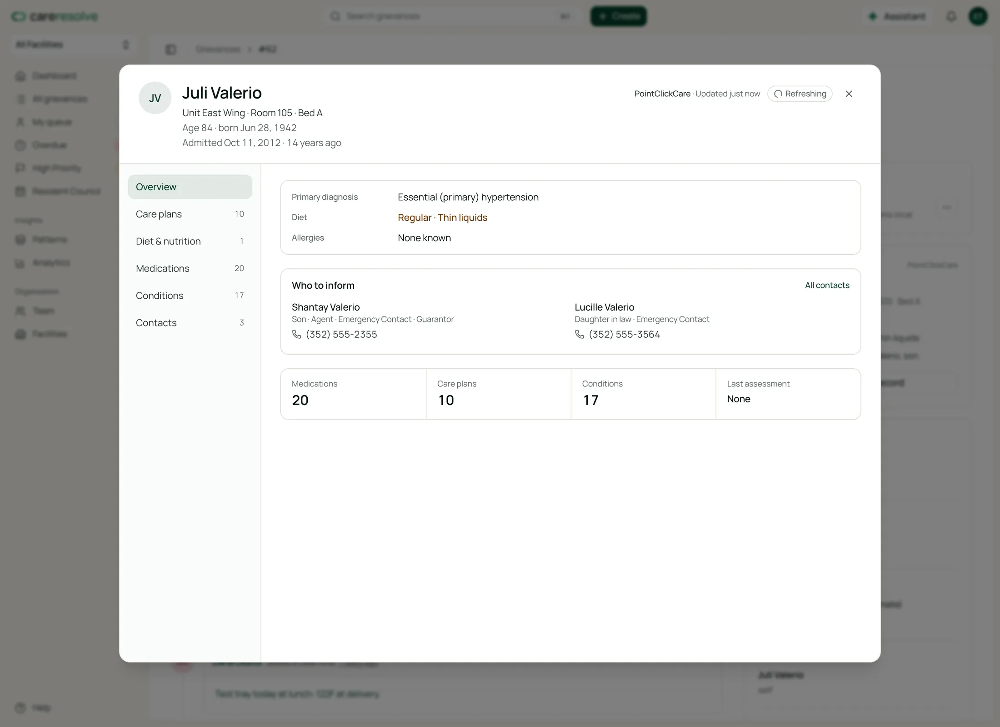

The PointClickCare integration lets your team link a resident to a grievance and review that resident's record without leaving the case.

<Note>
  These features apply only when PointClickCare is set up for your organization and the facility is linked. Contact your CareResolve account team to arrange setup. Facilities without a connection continue to use manual resident entry.
</Note>

## Connect a facility

Your authorized PointClickCare administrator activates CareResolve for the appropriate facilities in PointClickCare. The CareResolve team then confirms the organization and facility mappings and starts the initial resident and location sync.

An activation does not automatically link every facility. Each mapping is reviewed so resident information appears in the correct CareResolve facility. Setup is coordinated with CareResolve, not through the product app's facility settings.

## Select a resident during intake

In the **New grievance** composer, choose the facility, then use **PointClickCare resident** to search the synced directory by name, room, or unit. Selecting a resident fills their name and shows their unit and room.

If the resident is missing, select **Resident not listed** and enter the known details manually. Switching to manual entry clears the selected resident, so review the details before saving. Resident details can also be left blank when the concern does not identify a resident.

The same controls are available when [editing an unlocked internal intake record](/grievance-log/edit-original-submission). Resident Council submissions do not link an individual resident.

In the grievance list, a small PointClickCare marker beside the resident's name shows that the resident was selected from the synced directory.

## Review the resident record

On a linked grievance, the **Resident** card in the right rail is labeled **PointClickCare** and shows the resident's unit, room, age, diet, and responsible party. Select **Open resident record** to see more. The header shows the resident's name, unit, room, and bed, with their age and date of birth.

<Frame caption="The resident record opens over the grievance and is read-only.">
  
</Frame>

Sections appear only when there is something to show.

| Section | Information shown when available |
| --- | --- |
| Overview | Primary diagnosis, diet, allergies, who to inform, and counts of medications, care plans, and conditions |
| Allergies | Active allergies with reaction, severity, and onset date |
| Care plans | Focus areas, goals, and interventions |
| Diet & nutrition | Nutrition orders with texture and fluid consistency, and nutritional supplements |
| Medications | Active medications with strength, start date, and directions |
| Conditions | Active conditions and onset dates |
| Assessments | Recent assessments, shown 10 at a time with **Show more** |
| Contacts | Resident contacts and their relationships |

A missing section does not prove that a resident has no records of that kind. The facility's data and the access granted in PointClickCare determine what can be shown. Contacts are the resident's contacts, not a facility staff directory.

This information is read-only in CareResolve. Correct clinical records in PointClickCare. CareResolve does not write grievance notes, resolutions, or clinical changes back to PointClickCare.

## How information stays current

CareResolve keeps saved resident information so opening a case does not reload everything from PointClickCare each time.

- **Most resident details** update automatically when PointClickCare notifies CareResolve of a change. This includes conditions, allergies, medications, contacts, nutrition orders, and supplements.
- **Care plans and assessments** are requested again when you open the resident record, while the previously saved information stays visible.
- **Refresh:** the **Refresh** button at the top of the resident record requests care plans and assessments again. It does not reload the other sections, the facility's resident directory, or its location list.

Updates can take a moment to arrive. If a refresh fails, the previously saved information is kept.

Clinical dates use the PointClickCare facility's time zone, which the record names. Date-only values do not shift with the viewer's time zone.

## Link a public submission

On an unlocked public grievance, the Resident card may suggest a PointClickCare match using the submitted name and location. Review the full name, unit, and room before selecting **Link resident**. Suggestions can accommodate some spelling differences, but nothing is linked automatically.

The linked card shows the resident's synced identity and opens their record. The original public intake record remains unchanged, including the name and location the submitter entered.

To undo the link, open the resident record, open its three-dot menu, and select **Remove PointClickCare link**. This removes the association, not the grievance or the PointClickCare record. For an internal grievance, change the selection or use **Resident not listed** in its unlocked intake record instead.

## AI analysis and history

The advisory AI analysis can use the linked resident's available record alongside the grievance. Linking, changing, or removing a resident triggers fresh analysis on an open grievance. Removing a link excludes that resident's record from the new analysis.

Review suggestions against the actual report and records. A care plan or order describes documented care, not proof that it was delivered. AI does not change clinical records or resolve a grievance on its own.

Grievances retain their recorded resident name and location independently of later syncs. The linked Resident card can therefore show newer information than the intake record.

## If something is missing

- **No resident selector:** confirm the grievance's facility, then ask the CareResolve team whether that facility is connected.
- **Resident missing from search:** check the name, room, and unit. Use **Resident not listed** to continue, and ask the CareResolve team to check the directory sync if needed.
- **Missing or outdated care plans or assessments:** open the resident record and use refresh once. If the problem persists, contact support rather than refreshing repeatedly.
- **Location is read-only:** PointClickCare locations must be corrected at the source. Administrators can still manage custom CareResolve locations in [Facilities](/getting-started/facilities#locations).

For help, contact [support@careresolve.ai](mailto:support@careresolve.ai). Refer to the grievance by its ID rather than including resident details in a support message.
