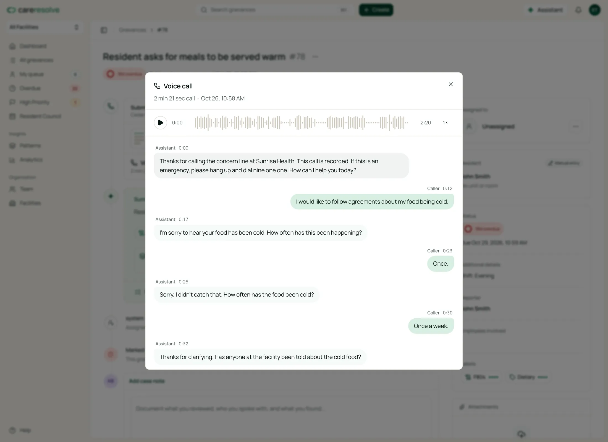

The concern line is a phone number for your organization. An AI voice agent answers, takes the concern in conversation, and files it as a grievance for the facility to review.

<Note>
  The concern line is set up by CareResolve for your organization. Contact your CareResolve account team to add one. Organizations without a concern line continue to use the public form and internal intake.
</Note>

## What a caller hears

1. A greeting that names your organization, tells the caller to hang up and dial 911 in an emergency, and states that the call is monitored and recorded.
2. A question about which facility the call concerns.
3. Questions about what happened, one at a time: when, how often, who was involved, and what the caller would like to see happen.
4. Questions about who is calling and which resident and room are involved. Every personal question can be skipped, so a caller can stay anonymous.
5. A request for permission to send the concern to the facility's grievance official. If the caller says no, nothing is filed.

The agent does not promise an outcome or a timeline, and it does not read out a grievance number.

## Share the number

When your organization has a concern line, the number appears beside the QR code in each facility's **Public intake** panel and is printed on the downloadable poster. Open **Facilities**, choose the facility, and find **Public intake** on the **Details** tab.

One number serves the whole organization. The caller chooses the facility during the call.

## Review a phone submission

A grievance filed by phone enters the same queues as any other grievance and receives the same AI intake analysis.

- The grievance list shows a phone marker on the grievance.
- The intake record is marked **Submitted by phone**.
- The **Voice call** section on the grievance offers **View transcript**.

<Frame caption="The transcript follows the recording; select a turn to jump to that moment.">
  
</Frame>

The transcript appears a few minutes after the call ends. Select any turn in the transcript to play the recording from that moment.

Like a public form submission, the phone intake record is read-only. Document corrections and later findings in a case note. You can still change the title, assignee, category, and F-tag while the grievance is unlocked.

## Privacy

Call recordings and transcripts can contain resident names and other sensitive details. Listen to and share them only inside CareResolve, and treat them like any other part of the case record.

<Card title="Review public submissions" icon="inbox" href="/public-intake/review-public-submissions">
  Work a grievance that arrived through the public form or the concern line.
</Card>
